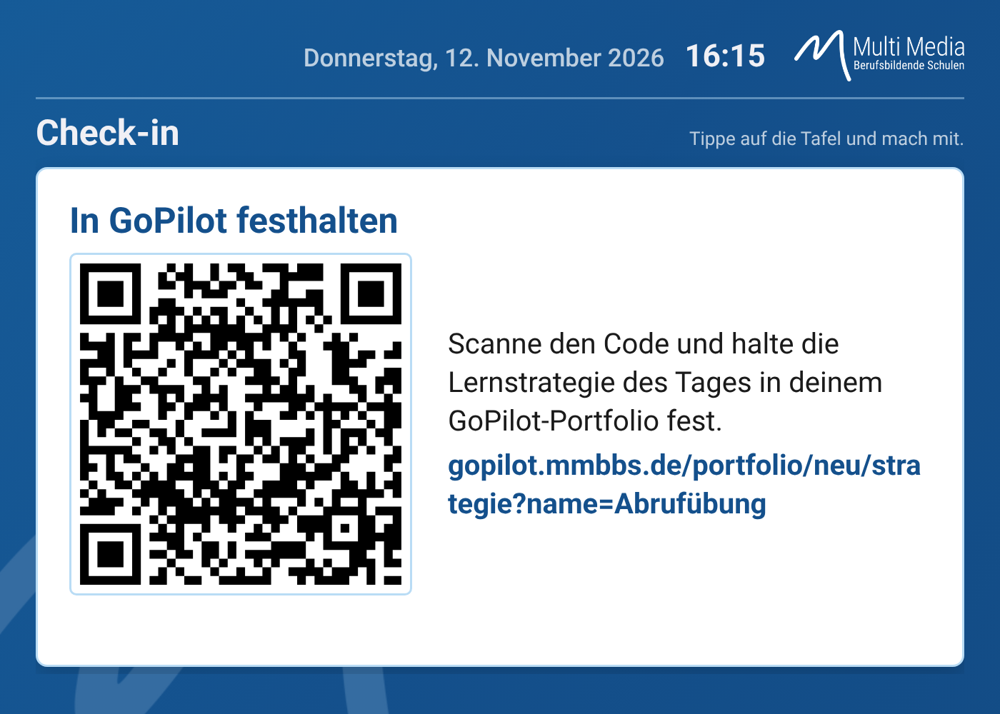

# MMBbS Teaching Assistant

Ein Unterrichtsassistent für Tafel und Beamer im Corporate Design der Multi Media Berufsbildenden Schulen Hannover.

**Aufrufen:** https://herr-fr.github.io/Gopilot_teaching-assistent/

## Funktionen

- Unterricht: Zufall, Timer, Lautstärke-Ampel, Karten, Sterne und Klassenziel
- Check-in mit Lernstrategie des Tages und Check-out mit Zufriedenheit, Lichtblicken und Reflexionsfragen
- Bibliothek mit Lernstrategien, Zufallsfragen in Fragenboxen, Sessionmarkt mit Warteliste
- Medien am Beamer: Webseiten, PDF, Bilder, Word, Videos und Text, dazu ein Fokus-Modus
- Vier Hauptmenüs mit Untermenüs: **Unterricht** (Zufall, Gruppen, Zufallsfragen, Timer, Lautstärke, Sterne, Karten, Klassen), **Beamer** (Medien, Sessionmarkt, Einstellungen), **Check-in** (Lernstrategien) und **Check-out** (Mini-Challenge)
- Gruppengenerator: zufällig nach Gruppengröße oder Anzahl, von Hand per Drag & Drop oder Antippen, Anzeige am Beamer
- Mini-Challenge des Tages mit Bibliothek, Zeit, Schwierigkeit, Auflösung und Material (PNG, JPG, PDF, HTML, H5P, Word oder Link), am Touch-Display direkt bearbeitbar
- Beamer individuell: in jedem Bereich einzelne Standardteile aus- und einblenden und eigene Felder (Text, Aufgabe, Liste, Bild, QR-Code, Countdown) mit Position, Größe und Anzeigezeitpunkt hinzufügen
- Bereich **Beamer** als zentrale Steuerung: Hauptfläche, Einblendungen, Karten, Fokus und Darstellung an einer Stelle
- QR-Codes, die bei den SuS einen vorausgefüllten Eintrag im GoPilot-Portfolio öffnen

## GoPilot-Portfolio per QR-Code

Der Teaching Assistant arbeitet mit der [GoPilot-Portfolio-Lernmappe](https://github.com/Herr-FR/GoPilot_Plugin_Portfolio-Lernmappe) zusammen:

1. Unter **Einstellungen > GoPilot** die Adresse eurer GoPilot-App eintragen, z. B. `https://gopilot.schule.de`.
2. Im **Check-in** oder **Check-out** auf **GoPilot-QR** klicken. Unter **Beamer** den Check-in oder Check-out auf die Hauptfläche holen und bei *Ansicht am Beamer* den QR-Code wählen.
3. Die SuS scannen den Code mit dem Handy. GoPilot öffnet einen vorausgefüllten Eintrag in ihrem Portfolio:
   - **Check-in:** die Lernstrategie des Tages mit Beschreibung, unter *Lernstrategien*. Wählst du eine andere Strategie, passt sich der Code automatisch an.
   - **Check-out:** ein Lerntagebuch-Eintrag mit denselben Fragen wie am Beamer.

Der QR-Code enthält nur einen Link. Aus dem Teaching Assistant werden keine Daten an GoPilot oder Moodle übertragen, alles bleibt wie bisher im Browser. Ohne GoPilot-Adresse ist die Funktion aus.

## Nutzung

1. Die Adresse oben in Chrome, Edge oder Safari öffnen.
2. Oben auf **Beamer** klicken, dann auf **Beamer-Fenster öffnen**, und das neue Fenster auf den Beamer ziehen.
3. Im Bereich **Beamer** legst du fest, was die Klasse sieht. In allen anderen Bereichen (Check-in, Check-out, Medien, Zufallsfragen …) bereitest du Inhalte nur vor.

**iPad:** Die Adresse in Safari öffnen und über Teilen > *Zum Home-Bildschirm* ablegen. So bleiben die Daten auch erhalten, wenn du die Seite länger nicht öffnest. Das Beamer-Fenster getrennt vom Dashboard anzeigen geht nur mit Stage Manager und externem Bildschirm (iPads mit M-Chip), sonst wird gespiegelt.

## Datenschutz

Alle Klassen, Namen, Karten und Dateien bleiben im Browser des jeweiligen Geräts. Die Seite schickt keine Eingaben an einen Server, setzt keine Cookies und nutzt kein Tracking. Die Anzeigeprogramme für PDF (PDF.js), Word (mammoth.js) und QR-Codes (qrcode-generator) sowie die Schrift Roboto sind in die Datei eingebaut, es wird nichts nachgeladen.

Externe Dienste kommen nur ins Spiel, wenn du sie selbst nutzt: eingebettete Webseiten und Videos unter *Medien*. H5P-Dateien werden im Browser entpackt und über `sw.js` (Service Worker) nur lokal aus dem Browser-Cache abgespielt; das funktioniert in der Online-Version, nicht in der lokal geöffneten Datei. Der H5P-Player stammt aus [h5p-standalone](https://github.com/tunapanda/h5p-standalone) (MIT-Lizenz). Sichere deine Daten regelmäßig unter *Einstellungen > Backup speichern*.

## Aktualisieren

Eine neue Version als `index.html` hochladen. Der Workflow unter `.github/workflows/pages.yml` veröffentlicht sie automatisch nach jedem Push auf `main`.

## Enthaltene Programme

PDF.js (Apache 2.0), mammoth.js (BSD-2-Clause), qrcode-generator (MIT). Die Lizenztexte stehen im Quelltext von `index.html`.

## Herkunft

- **Idee und Grundlage:** [classtiles.de](https://classtiles.de)
- **Weiterentwicklung:** Herr FR, MMBbS Hannover: MMBbS-Design, Medien und Fokus-Modus, Zufallsfragen, Check-in und Check-out, Lernstrategien, Sessionmarkt, Karten am Beamer je Farbe, Betrieb ohne Nachladen, QR-Codes ins GoPilot-Portfolio, Beamer-Zentrale, Menü mit Untermenüs, Gruppengenerator, Mini-Challenge mit H5P, Beamer individuell mit eigenen Feldern
